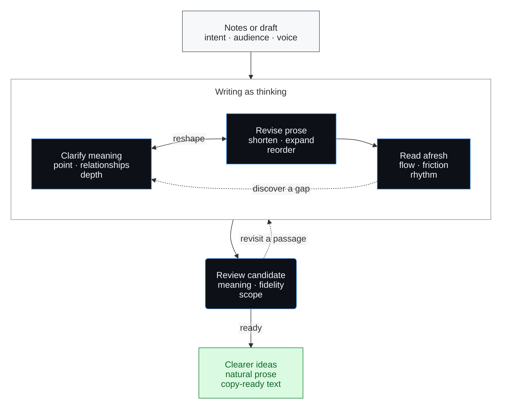

# Good Writing

An Agent Skill for developing ideas through writing, based on Paul Graham's
[Good Writing](https://www.paulgraham.com/goodwriting.html). Use it to turn notes
into essays or deeply revise arguments, opinion pieces, and technical explanations.

> **Better sentences can reveal better thoughts.**

## Core idea

Writing helps determine what you mean. An awkward sentence can expose a missing
relationship; a repeated phrase can reveal a duplicated idea. Reworking the prose
can change the argument, and a clearer argument can suggest better prose.

The aim is a worthwhile idea developed to the right depth, expressed in a way the
reader can follow naturally. This requires choosing the conclusions that matter,
giving subtle points enough room, and recognizing when a passage has nothing more
to say.

## Design



Work starts wherever wording or reasoning becomes unclear. A discovery can change
either one; only passages with a remaining problem need another pass.

| Mechanism | Design choice |
| --- | --- |
| **Shake the bin** | Try modest changes in length or arrangement. Keep revisions that improve meaning and readability together. |
| **First-reader feedback** | Reread for missing relationships, misplaced qualifications, and repetition. Easier reading makes these problems easier to notice. |
| **Natural rhythm** | Let sentence structure follow the complexity of the thought. Preserve a longer sentence when its qualification matters. |
| **Fidelity throughout** | Preserve facts, uncertainty, and the author's intent. Explain consequential changes to the thesis rather than silently replacing it. |

The skill preserves the requested language, voice, audience, and editing scope.
Proofreading requests receive surface corrections; substantive revisions return
usable text with brief notes only for material changes or unresolved questions.
Iteration stops when further changes offer little improvement beyond taste.

## Limits

This approach is strongest where writing develops ideas. When prose reports an
experiment, something built, or someone else's work, its fluency does not
establish the quality of that work. Internal consistency also cannot establish
that the premises are true. The skill preserves this boundary without imposing
a separate research-audit workflow.

## Install

Ask Codex:

```text
Use $skill-installer to install https://github.com/ZepinLi/good-writing/tree/main/good-writing into ~/.agents/skills/good-writing.
```

The inner `good-writing/` directory is the standalone skill. Installation copies a version; later repository changes require updating the installed copy.

## Use

```text
Use $good-writing to revise this essay, improving the reasoning and prose together. Preserve my voice and briefly explain consequential changes.
```

```text
Use $good-writing to develop these notes into a short essay without inventing facts.
```

The skill also activates for matching requests and respects proofreading-only instructions.

## References

- [Source argument map](good-writing/references/paul-graham-argument-map.md): Graham's claims and the skill's operating boundaries.
- [Revision examples](good-writing/references/revision-examples.md): invented demonstrations of compression, expansion, qualification, and organization.

The workflow and examples adapt Graham's ideas; they are not his prescribed procedure or original prose.
